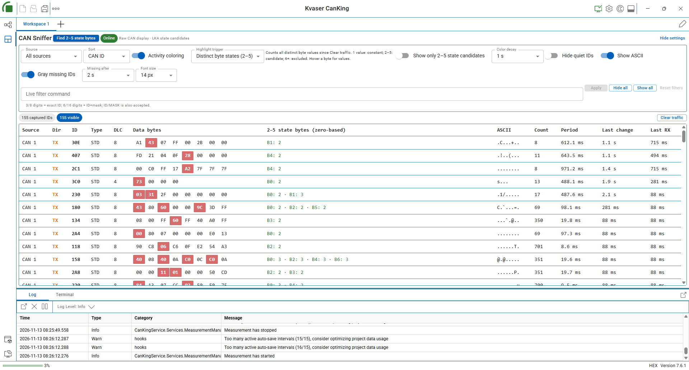
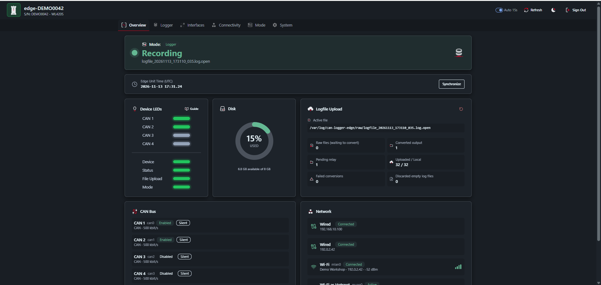

   &nbsp; AMERICAS

Build more with CanKing and Kvaser Edge.

Explore extensions, applications, and practical examples developed by the Kvaser Americas team.

[Website](https://kvaser.com) | [Global Kvaser GitHub](https://github.com/Kvaser) | [Our repositories](https://github.com/orgs/Kvaser-Americas/repositories)

> **Example software — provided as-is**
>
> These CanKing extensions and Kvaser Edge applications are provided **as-is, as examples**, without warranty or guaranteed technical support, updates, or bug fixes.
>
> You are responsible for evaluating, installing, configuring, testing, and maintaining any software you download, and for determining whether it is suitable for your use. Review each repository’s license, requirements, and limitations before use.

## CanKing extensions

Extend your CanKing workflow with tools built by our team. Find installation instructions, compatibility information, and examples in each repository.

### CAN Sniffer

Inspect raw CAN traffic in CanKing with a message table, changing-byte highlighting, and live filtering. Identify bytes with two to five distinct values to help explore possible state signals.

*CAN Sniffer running in CanKing.*

[Explore CanKing extensions and other projects](https://github.com/orgs/Kvaser-Americas/repositories)

## Kvaser Edge applications

Discover applications for Kvaser Edge. Each project includes its requirements, configuration steps, and guidance for deploying and running the application.

### Edge Log-Relay

Explore an example application for Kvaser Edge. The dashboard below shows recording status, disk usage, logfile upload information, CAN bus information, and network details.

*Edge Log-Relay example dashboard.*

[Explore Edge applications and other projects](https://github.com/orgs/Kvaser-Americas/repositories)

## Feedback and product support

You may report bugs and suggest improvements through a repository’s Issues tab, where enabled. Feedback is welcome, but a response or fix is not guaranteed. These examples are intended for self-service use.

For general Kvaser product information and support resources, visit [kvaser.com](https://kvaser.com). This does not imply support for the example software hosted here.

---

**Kvaser Americas**  
Tools and applications for engineers building with Kvaser.
